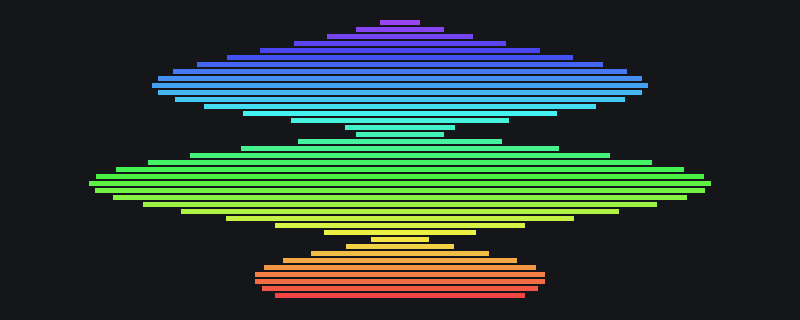

<p align="center"></p>

# wavelength

A browser engine written from scratch in Rust, with one measure of progress: render a page, overlay the result on Chrome's screenshot of the same page, and count the pixels that differ. The long-term goal is an engine small and fast enough to embed in AI agents, which is why everything it knows about a page is already exposed through a small library API.

The engine is at its first milestone. It parses HTML and CSS, runs the cascade, lays out block boxes and paints backgrounds and borders. Within that subset all three fixture pages in this repository match Chrome 157 exactly, with 0 of 480,000 pixels differing on each. It does not draw text yet, so it cannot render a real web page. [ROADMAP.md](ROADMAP.md) lists what is missing and the order it will be built in.



The image above is `fixtures/spectrum.html` as painted by the engine. Chrome produces the same picture, pixel for pixel.

## Quick start

You need a Rust toolchain at version 1.88 or newer. Chrome or Chromium is only needed for the comparison, because the engine itself never calls it.

```sh
cargo build --release
cargo run --release -- compare fixtures/*.html
open report/index.html
```

`compare` renders each page with the engine and with headless Chrome, then writes both images, a diff overlay and an `index.html` that shows the three side by side with the number of differing pixels. Pass `--max-diff 0` to make the command fail when any page is not an exact match, which is how the test suite uses it.

To render a single page without involving Chrome:

```sh
cargo run --release -- render fixtures/blocks.html --out blocks.png --width 800 --height 600
```

If Chrome is installed somewhere unusual, set `WAVELENGTH_CHROME` to the path of its binary. When no browser is found, `compare` reuses the reference screenshots left in the output directory by an earlier run.

## Using it as a library

`Page` wraps the whole pipeline, and it is the surface an agent integration is meant to build on. It gives an agent a screenshot, a way to find elements, the position of each element on screen and the page's text.

```rust
use wavelength::{Page, Viewport};

let page = Page::load(
    "<div id='box' style='width: 100px; height: 50px; background: teal'></div>",
    Viewport { width: 320, height: 240 },
);
let boxes = page.select("#box")?;          // elements matching a selector
let bounds = page.bounds(boxes[0]);         // where the element is drawn
let image = page.render();                  // RGBA pixels, savable as PNG
let text = page.text();                     // the text of the body
```

An MCP server and other agent-facing layers are planned on top of this API and are tracked in the roadmap.

## How it works

The pipeline is a straight line, and each stage is one module in `src/`.

| Stage | Module | What it does today |
|---|---|---|
| Parse HTML | `html.rs`, `dom.rs` | Tags, attributes, text, comments, void and raw-text elements, implied `html`, `head` and `body` |
| Parse CSS | `css.rs` | Style rules with type, class, id and descendant selectors, plus specificity |
| Cascade | `style.rs` | User-agent sheet, `<style>` elements, `style` attributes, inherited `color` |
| Layout | `layout.rs` | Block boxes with `width`, `height`, `margin`, `padding`, `border` and auto margins |
| Paint | `paint.rs`, `image.rs` | Solid backgrounds and borders, canvas background propagation, PNG output |
| Verify | `chrome.rs`, `diff.rs`, `report.rs` | Chrome reference screenshots, pixel diff, HTML report |

The fixtures stay inside what the engine supports, so an exact match there shows the implemented subset is correct and says nothing about the rest of CSS. Two gaps are worth knowing about before writing a new fixture: vertical margins do not collapse yet, and lengths must be in `px`.

## Development

```sh
cargo fmt --check
cargo clippy --all-targets -- -D warnings
cargo test                      # unit tests and the doc example
cargo test -- --include-ignored # also checks the fixtures against a local Chrome
```

The crate forbids `unsafe` code and treats missing documentation as a warning. Parsing and rendering never return errors, since a browser has to do something sensible with any input, and the error type only covers files, images and the command line.

### Dependencies

The engine has no dependencies. The crate has one, `png`, which reads Chrome's screenshots and writes the engine's output. Versions are pinned exactly in `Cargo.toml` and `Cargo.lock` is committed. Please keep it that way and prefer writing a small amount of code over adding a crate.

## License

[MIT](LICENSE)
